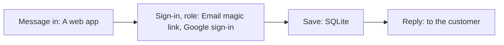

# Architecture

## One request

- **Message in**: The request arrives from a web app or web chat.
- **Sign-in, role**: People sign in (email magic link, google sign-in); every step below knows the tenant and the role, and the role’s permission is checked first (docs/AUTH.md).
- **Save**: Records with the tenant id, and a safe log line.
- **Reply**: The result goes back.

## Parts
- Code: Server pages with htmx · Python 3.12, FastAPI · SQLite. Details in docs/STACK.md.
- Data: SQLite; tenancy: one database, tenant id on every row and key. Tables in docs/DATA_MODEL.md.
- Sign-in: Email magic link, Google sign-in. Roles and permissions in docs/AUTH.md.
- Integrations: Email sending. Platforms: A web app.
- Billing: Stripe. Keep only the provider’s customer id; verify every webhook.
- Hosting: One server (VPS) with Docker, over HTTPS, with daily backups and an uptime check.

## Personal data (PDPA)
- Personal data: yes. Kept for: 90 days.
- Collect only what the features need; say why in a privacy notice.
- Logs hold no message text. Customers can ask for their data and for deletion.
- Plan what you do if data leaks: who you tell, and how fast.

## Ready before the first customer
- [x] A privacy notice (PDPA)
- [x] Terms of service
- [x] Sign-up and a guided first task
- [x] A support channel: email or WhatsApp
- [x] Daily backups, restored once
- [x] Uptime monitoring with an alert to your phone
- [ ] Product analytics, without personal data (not planned yet)

## Environment variables (.env, never committed)
- `APP_SECRET`
- `DATABASE_PATH`
- `EMAIL_API_KEY`
- `GOOGLE_CLIENT_ID`
- `GOOGLE_CLIENT_SECRET`
- `PAYMENT_API_KEY`
- `PAYMENT_WEBHOOK_SECRET`
