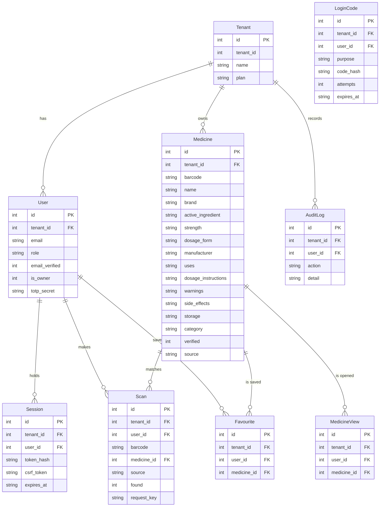

# Data model

Every table has an `id` and a `tenant_id`, and every query filters by the tenant.
Every list and search has an index (see `app/db.py`).

## Tables

| Table | Holds | Notes |
|---|---|---|
| `tenants` | one row per pharmacy | `tenant_id` equals `id`; the business's name and plan |
| `users` | staff | email is unique across the platform; role comes from `docs/AUTH.md` |
| `sessions` | signed-in sessions | stores only a SHA-256 hash of the cookie token, plus the CSRF token |
| `login_codes` | magic links and two-factor codes | hashed, single use, with an attempt counter |
| `auth_attempts` | failed and successful sign-ins | keyed by a keyed hash of the email, never the address itself |
| `medicines` | each business's verified catalogue | seeded from `app/seed_data.py` at tenant creation; `verified` decides whether dosage and warnings are shown |
| `scans` | scan history | `request_key` makes a retried submit save once |
| `medicine_views` | details page opens | proves the details page saves per business |
| `favourites` | saved medicines | one row per user and medicine |
| `audit_log` | who did what | tenant scoped, no message text |
| `rate_limits` | request counters | in SQLite, so a restart does not reset them |
| `idempotency_keys` | retry protection | used by payments and other repeatable actions in M7 |

Catalogue rows imported from Excel/CSV also fill `side_effects`, `storage`,
`category` and a JSON `extra_json` column (price, stock, expiry, pack, registration
number and similar supplier fields). See `docs/CATALOG_IMPORT.md`.

Medicine pictures are **not** database rows: the JPEG lives under
`MEDIA_PATH/<tenant_id>/<medicine_id>.jpg` and is served by
`GET /medicines/<id>/image`. See `docs/MEDICINE_IMAGES.md`.

## Why the catalogue is copied per tenant

The verified medicine reference is shared knowledge, but every row still carries a
tenant id: a pharmacy's catalogue can be corrected, extended or hidden for that
business alone, and the isolation tests can prove that a query for one business
never returns another's rows. When a global master catalogue arrives (M7), it will
be a separate, read-only source that seeds these rows.

## Personal data

Staff email addresses, roles and feature use. Kept for 90 days, then deleted or
anonymised (`docs/ARCHITECTURE.md`, `docs/OPERATIONS.md`). Logs hold no message
text and no email addresses.
